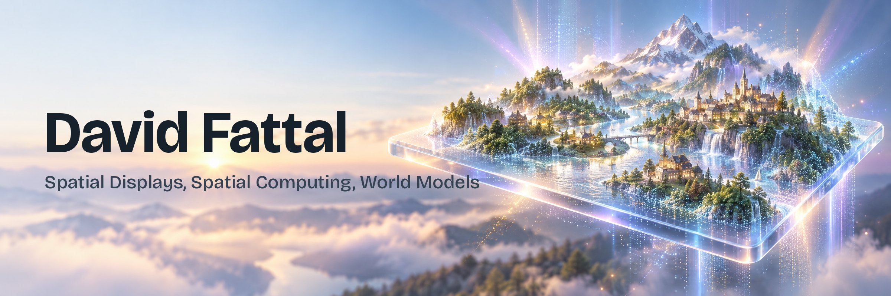

**Founder of [DisplayXR](https://displayxr.org)** · **Co-founder & CTO of [Leia](https://www.leiainc.com)** · **Author of [The Spatial Shift](https://thespatialshift.com)**

I work on glasses-free 3D: the optics, the software that drives it, and the 3D content and AI it needs.
Most of my code lives in the [DisplayXR](https://github.com/DisplayXR) organization.

---

### 🧊 DisplayXR: an open runtime for 3D displays

Spatial displays now ship from many vendors, but each app still integrates each panel by hand.
DisplayXR is a vendor-neutral, [OpenXR](https://www.khronos.org/openxr/)-based runtime: write an app once and it runs in 3D on any supported display.
It runs on Windows, macOS and Android. Display vendors plug in through a small display-processor interface.

| Start here | What it is |
|---|---|
| [**displayxr-runtime**](https://github.com/DisplayXR/displayxr-runtime) | The OpenXR runtime for tracked 3D displays |
| [**displayxr-browser**](https://github.com/DisplayXR/displayxr-browser) | Chromium that renders the web normally and adds inline 3D on DisplayXR hardware |
| [**displayxr-web**](https://github.com/DisplayXR/displayxr-web) | Inline-3D web samples and a JS helper |
| [**displayxr-unity**](https://github.com/DisplayXR/displayxr-unity) · [**displayxr-unreal**](https://github.com/DisplayXR/displayxr-unreal) | Engine plugins |
| [**displayxr-extensions**](https://github.com/DisplayXR/displayxr-extensions) | OpenXR extension specs and headers for 3D displays |
| [**displayxr-vendor-template**](https://github.com/DisplayXR/displayxr-vendor-template) | Starter kit for adding a new display |

Leia is a founding member and the first display vendor. The project is independent and open to every display maker.

### 🔬 Leia: glasses-free 3D, from the lab to products

Leia grew out of my research at HP Labs on diffractive light-field backlights:
[*A multi-directional backlight for a wide-angle, glasses-free three-dimensional display*](https://www.nature.com/articles/nature11972) (*Nature* 495, 348–351, 2013).
Today Leia builds switchable 3D displays with eye tracking and AI-based 2D-to-3D conversion for phones, tablets, laptops and monitors. → [leiainc.com](https://www.leiainc.com)

### ✍️ The Spatial Shift

Essays on spatial AI, world models and 3D displays: why the next step in AI needs real 3D data, and how displays and capture help get it.

- [Building the Foundation for Spatial Intelligence](https://thespatialshift.com/essays/building-the-foundation-for-spatial-intelligence)
- [From Meshes to Splats: The New Language of Spatial AI](https://thespatialshift.com/essays/from-meshes-to-splats)
- [The Missing Interface of Spatial Computing](https://thespatialshift.com/essays/the-missing-interface-of-spatial-computing): why spatial displays need their OpenXR moment
- [All essays →](https://thespatialshift.com/essays)

### 🧪 Experiments

- [**LIF-renderer**](https://github.com/dfattal/LIF-renderer): Three.js renderer for layered light-field (LIF) images
- [**GS-stereo**](https://github.com/dfattal/GS-stereo): Gaussian splats trained from stereo images and a point cloud

### 🎮 For fun: building 3D games with my son Leo ([@leofattal](https://github.com/leofattal))

Leo is also a DisplayXR contributor. He wrote the Minecraft Bedrock stereo mod for [DisplayXR Play](https://github.com/DisplayXR/displayxr-play-android) and some runtime fixes.

- [**racers**](https://github.com/leofattal/racers): a browser racing game, [play it](https://racers-psi.vercel.app)
- [**3dvideocall**](https://github.com/leofattal/3dvideocall): 3D video calls in the browser (WebRTC with DisplayXR inline 3D), [try it](https://3dvideocall.vercel.app)
- [**minecraft-bedrock-3d**](https://github.com/leofattal/minecraft-bedrock-3d): glasses-free 3D Minecraft on a Lume Pad 2

---

[dfattal.github.io](https://dfattal.github.io) (in 3D on a DisplayXR display) · [displayxr.org](https://displayxr.org) · [thespatialshift.com](https://thespatialshift.com) · [leiainc.com](https://www.leiainc.com) · [LinkedIn](https://www.linkedin.com/in/davidfattal/)
